<div align="center">

# Planly — AI Daily Planner for Telegram

**Type or say tomorrow's plan however you like. Get a beautifully designed day plan in your channel, a live checklist, reminders and progress reports.**

Multi-user · Uzbek / Russian / English · Text & voice · Gemini with Groq fallback · Runs free on Render + Supabase

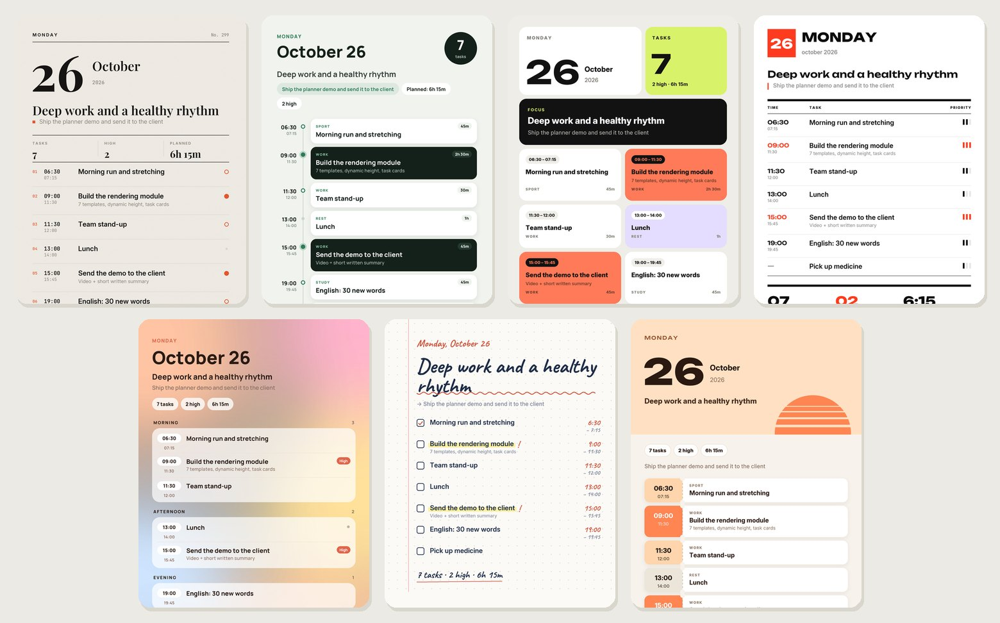

</div>

---

## Why

Planning works when it's effortless and visible. Planly turns a messy message like

> *"tomorrow gym at 7, deploy the bot 10–12 important, lunch, client call at 3, english in the evening, buy milk"*

into a structured, prioritized timeline, renders it as a designed image, posts it to your Telegram channel with a tap-to-tick checklist, nudges you before each task and tells you every week how you actually did.

## Features

| | |
|---|---|
| 🧠 **Understands anything** | Free-form text or voice notes in Uzbek, Russian, English or a mix. The AI fixes typos, splits items, infers times, priorities and categories. |
| 💬 **Chat mode** | Every message is routed automatically: new plan, *add* to a plan, *edit* a plan, *"gym done"*, *"remind me at 15:30…"*, a habit, a goal, or just a question it answers. |
| 🎨 **7 distinct templates** | Editorial, Sage timeline, Bento, Swiss, Soft gradient, Notebook, Sunrise — a different one every day (or pin your favourite). Layout density adapts from 3 to 30+ tasks. |
| ✅ **Live checklist** | The channel post carries tick buttons only the owner can press; the caption shows progress. |
| ➕ **Edit after posting** | Add or change tasks any time — the channel post updates *in place*, ticks are kept, and added tasks are visibly marked **+ Added** / 🆕. |
| ⏰ **Reminders** | A heads-up in DM before each task (with **Done** / **Snooze 15 min**), a task card in the channel when it starts, plus one-off personal reminders. |
| 🔁 **Habits** | *"Run every day at 7:00"* — habits are included in every new plan automatically. |
| 🎯 **Goals** | Long-term goals steer prioritization: tasks that serve them become high priority. |
| 🍅 **Focus timer** | 25 / 50 / 90-minute deep-work sessions with a ping at the end. |
| 🌙 **Daily rhythm** | Morning brief, evening wrap-up, *carry unfinished tasks* or *repeat today's plan* tomorrow in one tap. |
| 📊 **Reports** | Weekly and monthly images with completion ring, per-day bars, streak, best day and an AI insight. |
| 🧠 **Memory** | Remembers only durable facts (work hours, routines, goals) to plan better — viewable and deletable. |
| 🔐 **Bring your own AI** | Each user adds their own free Gemini and Groq keys (with in-bot step-by-step instructions). Keys are encrypted at rest. |

## A closer look

<table>
<tr>
<td width="33%">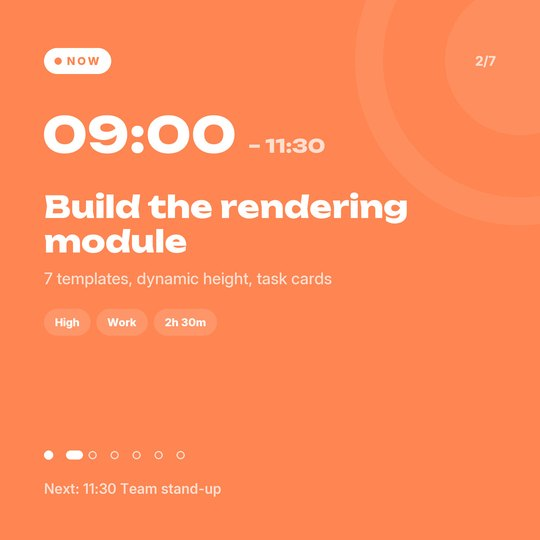<br><sub><b>Task card</b> — posted to the channel when a task starts, styled by priority.</sub></td>
<td width="33%">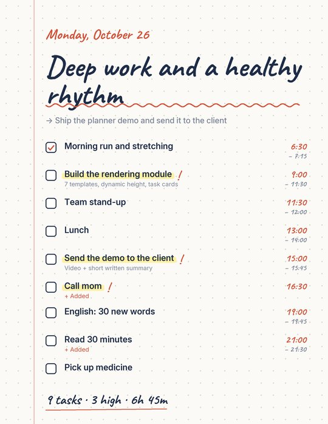<br><sub><b>Edited plan</b> — tasks added after posting are marked <i>+ Added</i>; ticks stay.</sub></td>
<td width="33%">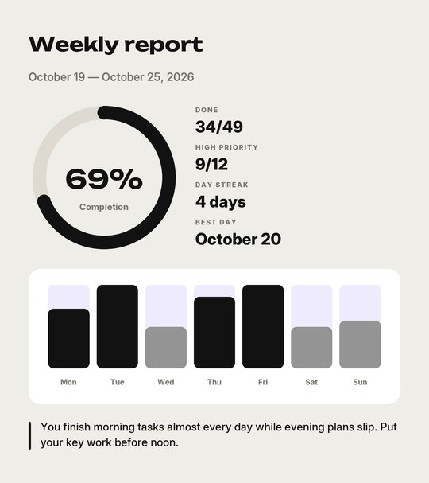<br><sub><b>Weekly report</b> — completion, streak, best day and an AI insight.</sub></td>
</tr>
</table>

<details>
<summary><b>All seven templates in full size</b></summary>

| Editorial | Sage | Bento | Swiss |
|---|---|---|---|
| 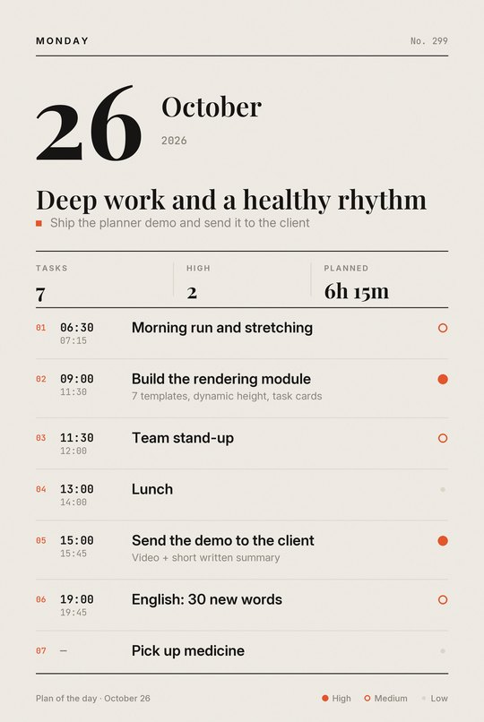 | 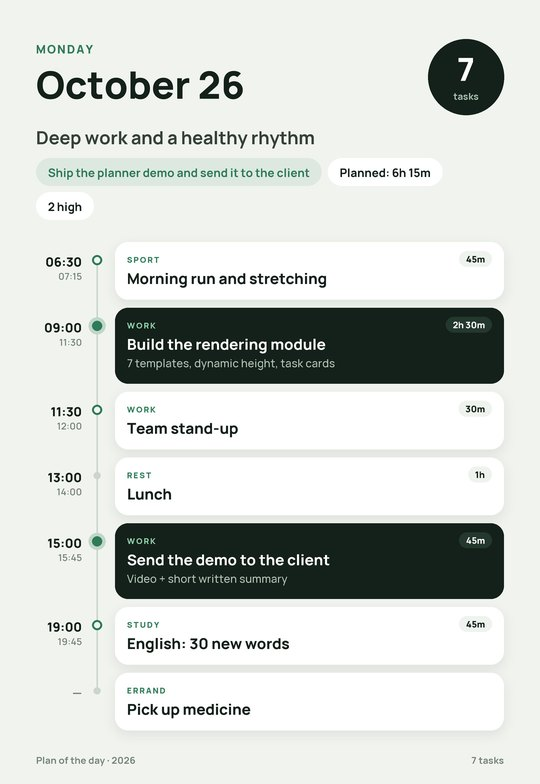 | 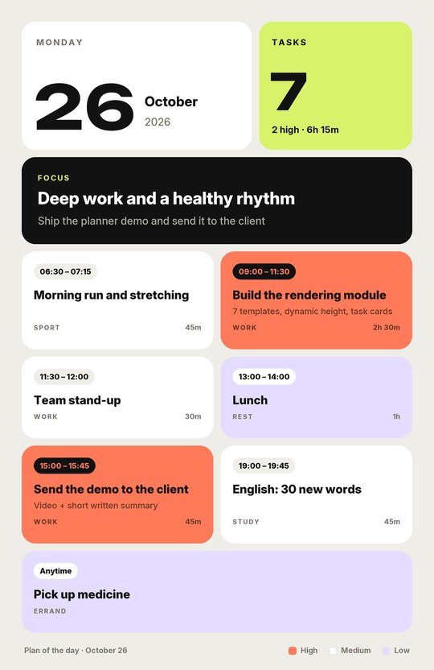 | 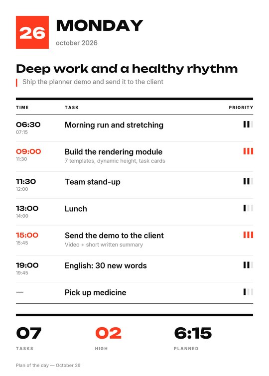 |

| Soft | Notebook | Sunrise |
|---|---|---|
| 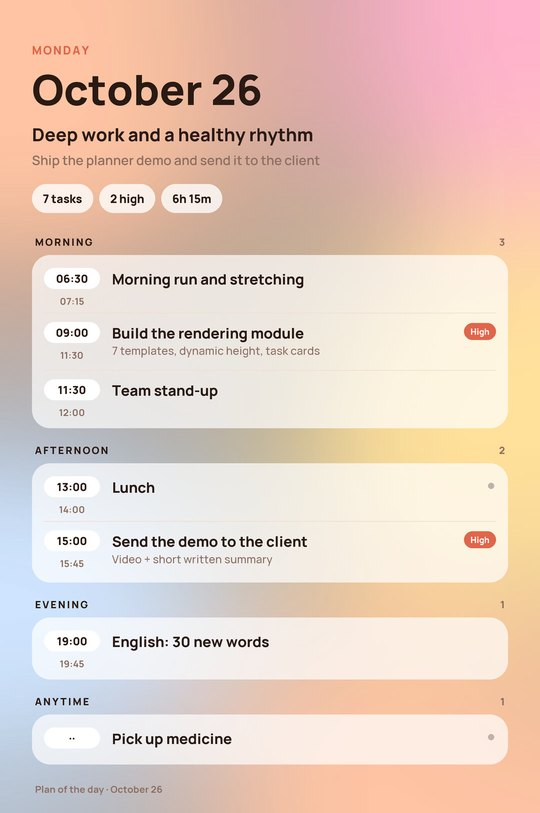 | 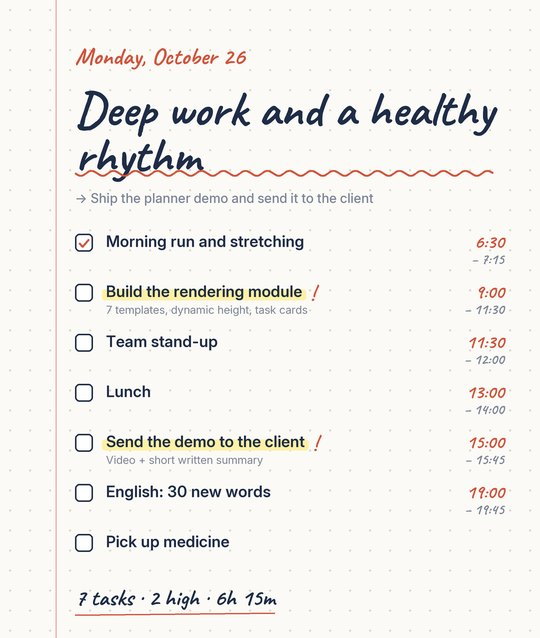 | 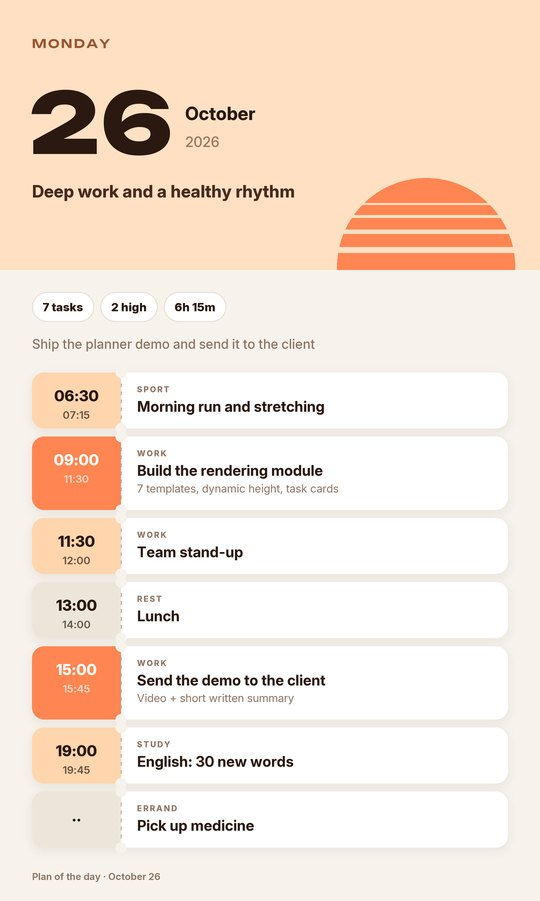 |

</details>

## How it works

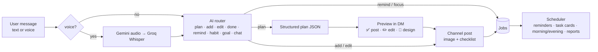

**Model orchestration.** Each call walks a chain: Gemini models first, Groq when Gemini is rate-limited, overloaded or failing. Models the key can access are discovered at runtime, so renamed or retired models don't break the bot; busy models are skipped for two minutes and calls time out early instead of hanging.

**Rendering.** Images are drawn with Pillow at 2× and downscaled — crisp, light (≈0.2–0.6 s per image, fits a 512 MB free instance) and fully dynamic in height. Fonts are bundled (SIL OFL) with automatic glyph fallback for Uzbek and Cyrillic characters.

**Reliability.** All scheduled work lives in Postgres, so restarts or a sleeping instance lose nothing; stale items are skipped rather than spammed.

## Commands & menu

The persistent menu is always on screen: **📝 Plan · 📅 Today · 🌅 Tomorrow · ⏰ Reminders · 🍅 Focus · 📊 Report · 🎯 Goals & habits · ⚙️ Settings**.

| Command | What it does |
|---|---|
| `/start` | Onboarding: language → Gemini key → Groq key → time zone → channel |
| `/today` | Today's plan with the checklist |
| `/report` | This week, last week or this month |
| `/memory`, `/remember <text>` | What the bot remembers about you |
| `/templates` | Preview all 7 designs with your own plan and pick one |
| `/keys` | Replace keys, with how-to guides |
| `/settings` | Language, channel, time zone, post times, notifications, template |
| `/help`, `/cancel` | Help · cancel the current step |

**Things you can just type:** *"add a call with Ali at 16:00"*, *"move lunch to 13:30"*, *"milk done"*, *"remind me in 20 minutes to stretch"*, *"I want IELTS 7.5 by June"*, *"every day at 7 run 20 minutes"*, *"what's left for today?"*

## Deploy (free)

**Stack:** Render (web service, webhook) · Supabase Postgres · cron-job.org (keeps the free instance awake and drives scheduled work).

1. **Bot** — create one with [@BotFather](https://t.me/BotFather) and copy the token.
2. **Database** — create a [Supabase](https://supabase.com) project. Use the **Transaction pooler** connection string (`…pooler.supabase.com:6543`); the direct `db.<ref>.supabase.co` host is IPv6-only and unreachable from Render. Tables are created automatically on first start.
3. **Encryption key** — `python scripts/gen_key.py`. Keep it forever: it encrypts users' API keys.
4. **Render** — push this repo to GitHub, then *New → Blueprint* and select it (`render.yaml`). Fill `BOT_TOKEN`, `DATABASE_URL`, `ENCRYPTION_KEY`; `WEBHOOK_SECRET` and `TICK_KEY` are generated. Pick the region closest to your database.
5. **cron-job.org** — create a job that calls `https://<app>.onrender.com/tick?key=<TICK_KEY>` every 5 minutes.

Check: `https://<app>.onrender.com/health` returns `ok`, and the logs show `webhook set to …/webhook`. Every `git push` redeploys automatically.

> Don't run the bot locally while the Render instance is live — local polling removes the webhook.

## Local development

```bash
python -m venv .venv
.venv/Scripts/pip install -r requirements.txt   # Linux/macOS: .venv/bin/pip
cp .env.example .env                             # BOT_TOKEN, DATABASE_URL, ENCRYPTION_KEY
python -m bot.main                               # no PUBLIC_URL → long polling
```

Design work: `python scripts/preview.py` renders every template into `previews/`; `python scripts/make_docs.py` regenerates the README images.

## Tests

```bash
python tests/test_core.py                                    # offline: parsing, time zones, scheduling, model ranking, AI fallback
TEST_DATABASE_URL=postgresql://... python tests/test_db.py   # SQL against a real Postgres
TEST_DATABASE_URL=postgresql://... python tests/test_flow.py # the whole bot end-to-end with a fake Telegram and fake AI
```

## Project structure

```
bot/
  main.py         aiohttp server: /webhook, /health, /tick — or long polling locally
  handlers.py     onboarding, menu, chat routing, plans, checklist, reminders, focus, goals, settings, reports
  planner.py      plan creation, add/edit merging with stable task ids, scheduling
  ai.py           Gemini → Groq orchestration, model discovery, speech-to-text
  prompts.py      prompts for planning, routing, adding, memory and reports
  scheduler.py    reminders, task cards, focus timers, daily posts, reports
  channel.py      channel post, checklist, in-place updates
  reports.py      weekly / monthly statistics
  db.py           Postgres schema and queries
  i18n.py, i18n_extra.py   Uzbek / Russian / English strings and the menu
  render/         Pillow toolkit, 7 templates, task and report cards
assets/fonts/     bundled Google Fonts (SIL Open Font License)
docs/images/      README images (generated)
```

## Security notes

- Users' Gemini/Groq keys are encrypted with Fernet (`ENCRYPTION_KEY`); messages containing keys are deleted immediately.
- Telegram webhook requests are verified with a secret token; `/tick` requires `TICK_KEY`.
- Only the channel owner can tick tasks; everyone else gets an alert.
- Never commit `.env`. Rotate any credential that has been shared in plain text.
